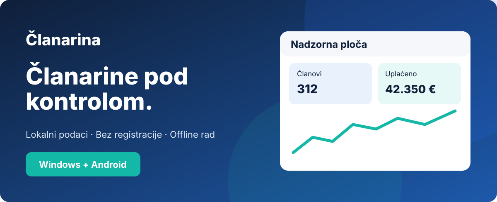
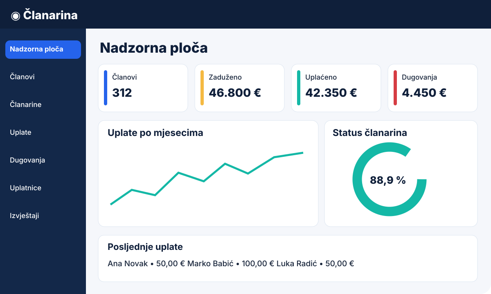
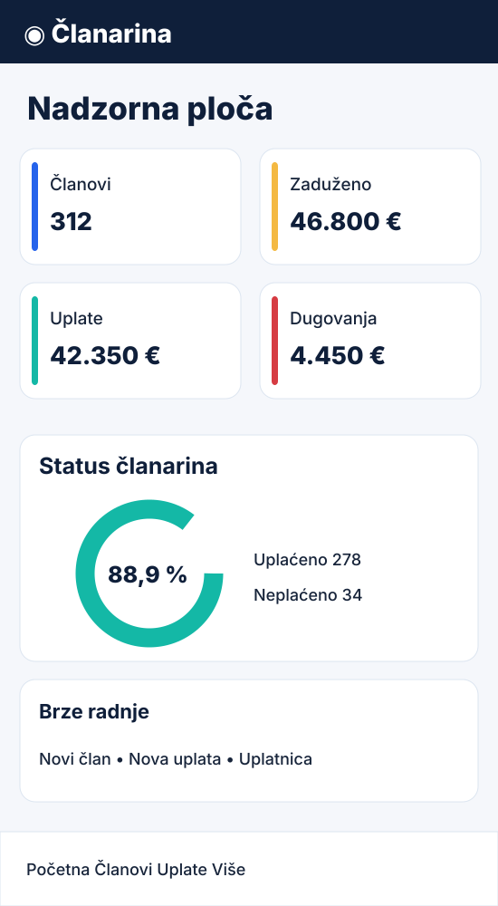

  
  <h3>Članarine pod kontrolom.</h3>
  
Članovi · Zaduženja · Uplate · Dugovanja · Uplatnice · Izvještaji

  
<strong>Windows + Android · Offline-first · Bez registracije · Bez clouda</strong>

  

> **Razvojna faza:** početna implementacija. Članarina nije još izdana kao produkcijska aplikacija; snimke i prikazi u README-u su **dizajnerski koncepti**, ne dokazi funkcionalnosti.

## Zašto Članarina?

Članarina je planirani nativni sustav za klubove i udruge koji žele voditi članstvo i članarine bez korisničkih računa, mjesečne ovisnosti o oblaku ili slanja osobnih podataka van uređaja. Usmjeren isključivo na članove i članarine, ne na opće knjigovodstvo.

| | Windows | Android |
|---|---|---|
| Nativno sučelje | WinUI 3, C#/.NET | Kotlin, Jetpack Compose |
| Lokalna pohrana | SQLite | Android SQLite |
| Osnovna navigacija | ✓ razvojna osnova | ✓ razvojna osnova |
| Članovi, zaduženja, uplate | djelomična implementacija | djelomična implementacija |
| Bankovni izvodi / HUB-3 | planirano | planirano |
| Online/ručna offline licenca | specifikacija protokola | specifikacija protokola |
| Produkcijski APK/AAB/EXE | nije izdano | nije izdano |

## Koncepti sučelja
<table><tr><td width="65%"><strong>Windows · Nadzorna ploča (koncept)</strong> </td><td width="35%"><strong>Android · Početna (koncept)</strong> </td></tr></table>

## Funkcionalne cjeline

🧑‍🤝‍🧑 **Članovi** — registri, status, grupa, pretraživanje.  
🪙 **Članarine** — periodičnost, iznosi i zaduženja.  
✅ **Uplate** — evidencija primitaka i status.  
⚠️ **Dugovanja** — dospjela nepodmirena zaduženja.  
📄 **Uplatnice** — HUB-3 i EPC QR (planirano, bez lažnog prikaza validnih kodova).  
🏦 **Bankovni izvodi** — uvoz i uparivanje (planirano).  
📊 **Izvještaji** — analitika i izvoz.  
🔐 **Licence** — online i ručna offline aktivacija s digitalnim potpisom (razvoj).

## Ustroj repozitorija

- [android/](android/) — nativni Android projekt
- [windows/](windows/) — nativni WinUI 3 projekt
- [licensing/](licensing/) — samostalni PHP/JSON licencni servis (bez baze)
- [site/](site/) — statička prezentacija i marketing
- [branding/](branding/) — SVG logo, ikona i ilustracije sučelja
- [design/tokens.json](design/tokens.json) — izvorne boje, spacing, tipografija
- [docs/BRAND.md](docs/BRAND.md) — pravila brenda
- [docs/SCREENS.md](docs/SCREENS.md) — katalog i kriteriji 1:1
- [docs/SECURITY.md](docs/SECURITY.md) — sigurnost, distribucija i otvoreni rizici

## Privatnost i aktivacija

Bez obvezne registracije. Poslovni podaci ostaju na uređaju. Za online aktivaciju samo podaci nužni za provjeru licence odlaze HTTPS licencnom servisu. Ručna offline aktivacija koristi potpisani odgovor; privatni ključ **nikada** ne smije u aplikaciju ni repozitorij. Opoziv licence nije trenutno provediv na stalno offline uređaju.

## Izrada

Android: otvoriti [android/](android/) u Android Studiju, instalirati odgovarajući Android SDK, pa pokrenuti debug build. Windows: otvoriti [windows/Claniva/Claniva.csproj](windows/Claniva/Claniva.csproj) u Visual Studiju s WinUI 3 workloadom. Ovaj repozitorij trenutačno ne sadrži potvrđene produkcijske buildove ni digitalne potpise.

## Razvojni status

- [x] Identitet Članarina i centralni dizajn tokeni
- [x] Projektna struktura, marketinški vizuali i katalog ekrana
- [ ] Potpuna funkcionalnost i migracijski testovi na obje platforme
- [ ] Pravi screenshotovi i usporedba RGB/SSIM svih stanja
- [ ] Bankovni uvoz, stvarna validacija HUB-3/EPC QR
- [ ] Potpuno licenciranje i sigurnosni audit
- [ ] Produkcijski potpisani installer, APK i AAB
- [ ] Play Console provjere politike prodaje/aktivacije

© 2026 BRENDIGO · [MIT License](LICENSE)
